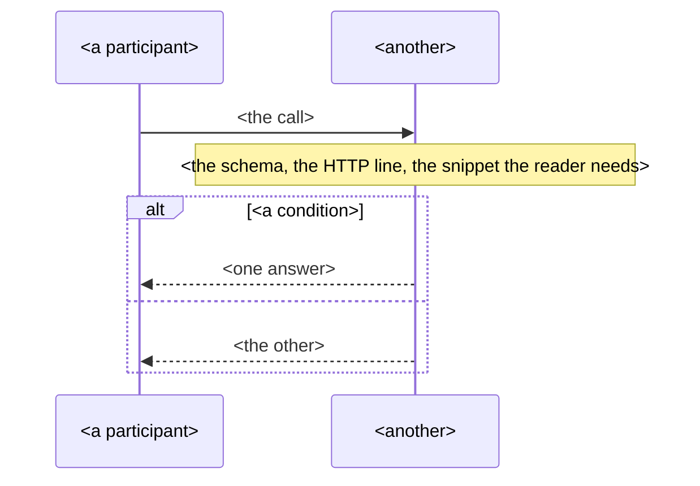

# NNNN. The decision in one sentence

Status: proposed
Implemented by: none yet
Diagrams: docs/diagrams/NNNN-<name>.mmd

## Abstract

The decision in three to five sentences: the problem, what we will implement, what it
gives us, what it costs.

## Introduction

Why we are here: the contract, the constraint, the review or the failure that raised the
question, with enough of the history that a reader new to the project follows.

## Problem at hand

The problem in detail. A table of examples: the input, what happens today, what must
happen. A sequence diagram when the problem is a flow. The articles or the standards
that frame it, linked under References.

## Proposed solution

We will implement <the pattern or the practice, linked under References>. <The pattern>
will allow us to <what it makes possible here>. This gives us <the benefits> at the cost
of <the consequences>.

Then: the rules of the solution as a table; the flow as a sequence diagram, its relative
path on the line above a mermaid block that is a copy of the file; the invariants a test
must cover; what stays undecided and who decides it.

docs/diagrams/NNNN-<name>.mmd

## Alternatives

- **<An alternative>.** Why it was considered, in two lines. Why it was ruled out, in two
  lines. About 75 words in all.

## Reconsider when

- <a condition that reopens this decision, one per bullet, checkable>

## References

- <Title>, <author or standard>: <link>
- <a changelog entry or a contract section, by id>

## Date and edits

| Date | Edit | Asked by |
|---|---|---|
| YYYY-MM-DD | the first draft | <who> |

Edits: 0.
